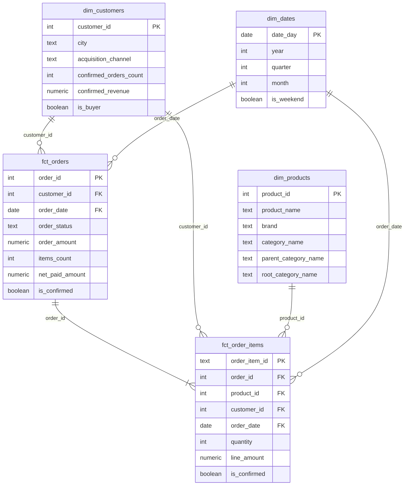
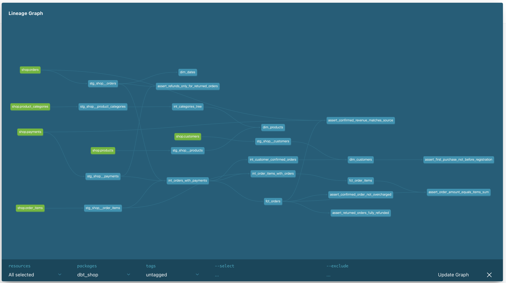

# store_hse

Домашнее задание 1: витрины интернет-магазина по схеме «звезда» в Greenplum.

## Как запустить

```
docker compose down -v && docker compose up -d
docker compose logs loader
docker compose run --rm dbt deps
docker compose run --rm dbt build
```

Команда `dbt deps` обязательна: в проекте подключён пакет `dbt_utils`, а папка `dbt_packages/`
в репозиторий не кладётся. Без неё модель `dim_dates` не соберётся.

## Модель данных

В центре два факта, вокруг них три измерения.



### Витрины

| Витрина | Одна строка — это | На какой вопрос отвечает |
|---|---|---|
| `fct_orders` | заказ, кроме тестовых | выручка по дням и месяцам, средний чек по городам |
| `fct_order_items` | товар в заказе | выручка по категориям и брендам, возвраты по брендам |
| `dim_customers` | клиент, в том числе не купивший | доля покупателей по каналам привлечения |
| `dim_products` | товар | к какой категории и к какому верхнему уровню относится |
| `dim_dates` | день | группировка по месяцам и кварталам, будни и выходные |

Подтверждённая покупка везде понимается одинаково: заказ в статусе `paid`, по которому прошла
хотя бы одна успешная оплата. Возврат оплатой не считается. Определение лежит в `models/docs.md`.

Самым сложным оказалось дерево категорий. Сначала я хотела просто два раза присоединить справочник
к самому себе, но тогда третий уровень не раскрывался. Переделала через рекурсивный запрос,
теперь и четвёртый уровень посчитается, если его добавят.

### Хранение в Greenplum

| Витрина | Распределение | Почему |
|---|---|---|
| `fct_orders` | `distributed by (order_id)` | значения уникальные, строки ложатся ровно; по этому ключу заказы соединяют с позициями |
| `fct_order_items` | `distributed by (order_id)` | тот же ключ, что у `fct_orders`, поэтому позиции лежат на том же сегменте, что и заказ |
| `dim_customers` | `distributed replicated` | всего 40 строк, копия на каждом сегменте, соединение без пересылки |
| `dim_products` | `distributed replicated` | 13 строк, то же самое |
| `dim_dates` | `distributed replicated` | 133 строки, соединяется с обоими фактами |

В `init/greenplum/load_raw.sql` сырые `orders`, `order_items` и `payments` тоже распределены
по `order_id`. Я взяла тот же ключ, чтобы заказ и его позиции лежали на одном сегменте
и в сыром слое, и в витринах. Если бы у `fct_order_items` ключ был другой, скажем `product_id`,
то при соединении по `order_id` строки одного заказа оказались бы на разных сегментах,
и Greenplum пересылал бы одну из таблиц между ними.

Колоночное хранение не ставила: таблицы маленькие и узкие, смысла нет. Если `fct_order_items`
сильно вырастет и отчёты будут читать из неё две-три колонки, стоит вернуться к этому.

Проверить, что получилось:

```sql
select c.relname, pg_get_table_distributedby(c.oid) as distribution, am.amname as storage
from pg_class c
join pg_namespace n on n.oid = c.relnamespace
left join pg_am am on am.oid = c.relam
where n.nspname = 'analytics_marts' and c.relkind = 'r';
```

### Граф зависимостей

```
docker compose run --rm dbt docs generate
docker compose run --rm --service-ports dbt docs serve --host 0.0.0.0 --port 8080 --no-browser
```



## Тесты

На ключи моделей стоят `unique` и `not_null`, от фактов к измерениям — `relationships`,
на статусы заказа и платежа — `accepted_values`. Свой тест `non_negative` лежит
в `tests/generic/non_negative.sql`, проверяет, что значение не меньше нуля,
и стоит на колонках с суммами и количествами.

Своих проверок на бизнес-логику получилось пять. Сумма заказа должна совпадать с суммой его
позиций. Выручка в витрине должна совпадать с посчитанной напрямую по сырым `orders` и `payments`.
По возвращённому заказу деньги должны вернуться полностью. Подтверждённому заказу не должны были
списать больше его суммы. И первая покупка не может быть раньше регистрации — эту я добавила сама.

Четвёртая из них, `assert_confirmed_order_not_overcharged`, находит заказ **113**: сам заказ стоит
200, а успешных оплат по нему две по 200, то есть списали 400. Это двойное списание в источнике,
а не ошибка витрины. Данные я не трогала, как и просит задание, а тест перевела в `severity: warn`,
чтобы проблема была видна при каждой сборке. Из-за неё выручку я считаю по `order_amount`,
а не по `paid_amount`.

## Дополнительное задание

Из двух вариантов выбрала пакет `dbt_utils`. Подключила его через `packages.yml` и сделала
календарь `dim_dates` макросом `date_spine`: он генерирует все дни 2026 года, а модель оставляет
только те, что попадают между первым и последним заказом. Получается 133 дня.

Год записан прямо в модели. Если появятся заказы за 2027-й, тест `relationships` на `order_date`
упадёт, и дату нужно будет поправить.

## Проверка результата

Сверилась с таблицей из задания: 135 заказов, 106 подтверждённых на 91 620, 425 позиций,
40 клиентов, 13 товаров, 133 дня. Выручка по верхним категориям — Electronics 59 994,28
и Home 31 625,72. `dbt build` проходит с одним предупреждением и без ошибок.